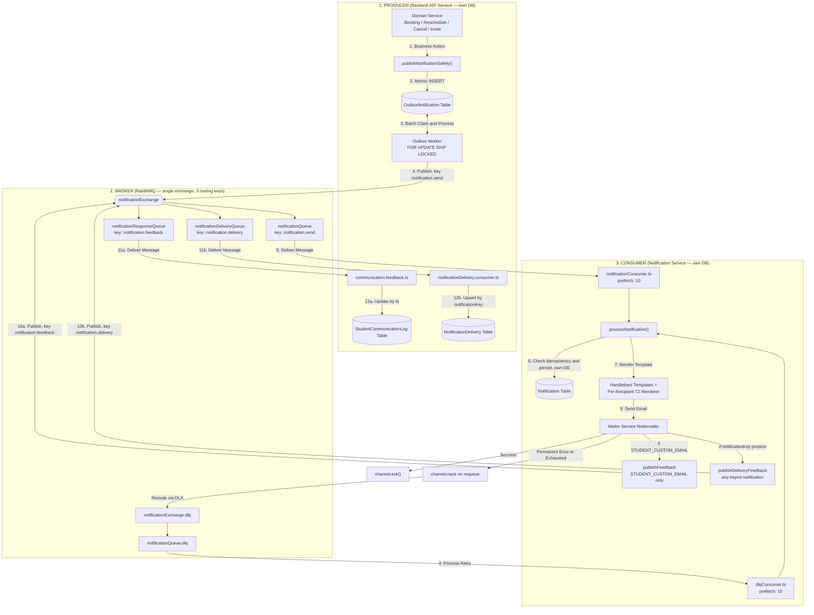

# Notification Delivery Flow — Outbox → RabbitMQ → notification-service

End-to-end path from a backend domain action queuing a notification through to
the email being sent and delivery status being reported back — including the
DLQ retry path and the two independent feedback loops.

**notification-service has its own PostgreSQL database, separate from the
backend's.** The two services never share a schema or connection — everything
crosses the boundary via RabbitMQ.

## File map

| Layer | File | Role |
|---|---|---|
| Producer | `backend/src/shared/notifications/notification.publisher.ts` | `publishNotificationSafely()` — entry point for all 49 notification types |
| Outbox table | `backend/prisma/schema.prisma` (`OutboxNotification`) | Transactional outbox, backend's own DB |
| Outbox worker | `backend/src/shared/notifications/outbox.worker.ts` | `FOR UPDATE SKIP LOCKED` claim + publish + retry |
| Main consumer | `notification-service/src/consumers/notificationConsumer.ts` | Binds `notificationQueue`, prefetch 10 |
| DLQ consumer | `notification-service/src/consumers/dlqConsumer.ts` | Binds `notificationQueue.dlq`, prefetch 10 |
| Dispatch | `notification-service/src/consumers/processNotification.ts` | Routes to email channel or cancellation |
| Send + idempotency | `notification-service/src/services/notificationService.ts`, `notificationRepository.ts` | `Notification` table, notification-service's own DB |
| Feedback publish | `notification-service/src/services/feedbackPublisher.ts` | `publishFeedback()` (legacy, student-email-only) + `publishDeliveryFeedback()` (generic) |
| Feedback consume | `backend/src/shared/notifications/communication.feedback.ts` | Updates `StudentCommunicationLog` |
| Delivery consume | `backend/src/shared/notifications/notificationDelivery.consumer.ts` | Upserts `NotificationDelivery` |

## RabbitMQ topology

One exchange, three routing keys, three queues:

| Exchange | Routing key | Queue | Bound by |
|---|---|---|---|
| `notificationExchange` | `notification.send` | `notificationQueue` (DLX → `notificationExchange.dlq`) | `notification-service` |
| `notificationExchange` | `notification.feedback` | `notificationResponseQueue` | `backend` (`communication.feedback.ts`) |
| `notificationExchange` | `notification.delivery` | `notificationDeliveryQueue` | `backend` (`notificationDelivery.consumer.ts`) |

`notification.feedback` only fires for `STUDENT_CUSTOM_EMAIL` sends (legacy
path, updates `StudentCommunicationLog` by id). `notification.delivery` fires
for **any** notification carrying a `notificationKey` (updates
`NotificationDelivery`, upserted by `notificationKey`) — `STUDENT_CUSTOM_EMAIL`
sends trigger both.

## Call flow diagram (flowchart)

## Related flows

- [Booking creation](./booking-creation.md) — queues `BOOKING_CREATED`/reminder notifications via `publishNotificationSafely()`.
- [Event creation](./event-creation.md)
